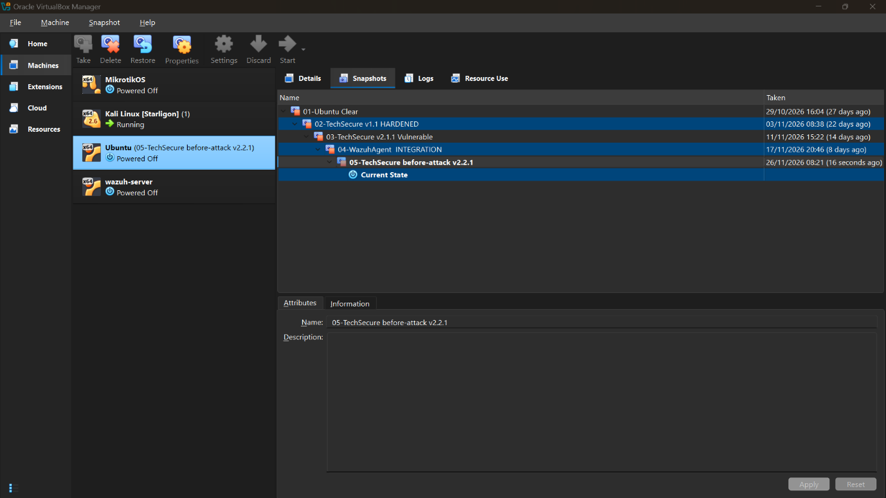
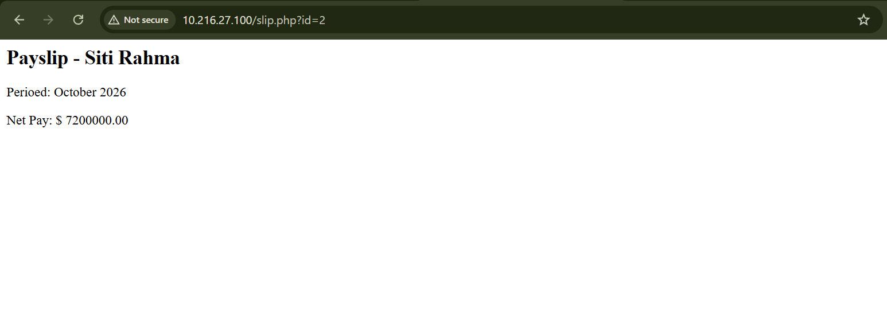
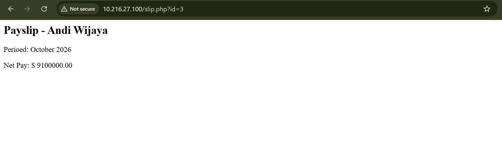
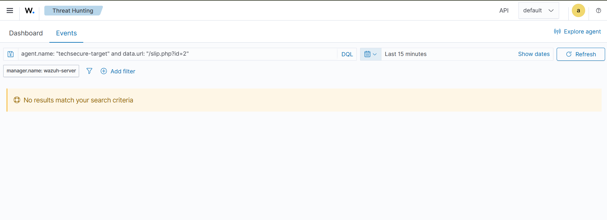
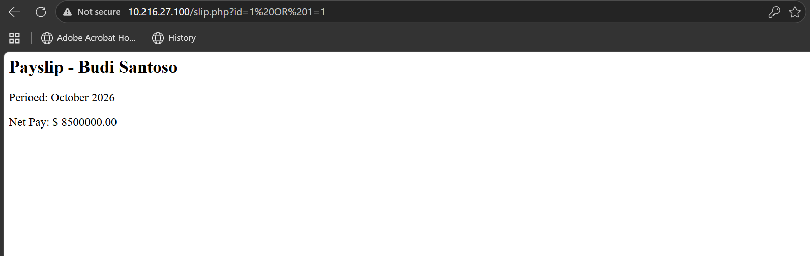
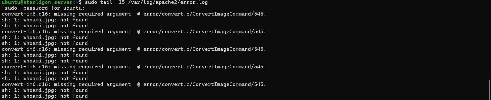

# ⚔️ Redteam Homelab Toolkit v2.0.0: Attack Simulation

<div align="center">


</div>

<div align="center"><sub>Each weakness documented in <a href="https://github.com/pagarkristian/enterprise-homelab-core/blob/main/v2.0.0/v2.1.1-vulnerable-features.md">v2.1.1-vulnerable-features.md</a> is exercised here, then checked against Wazuh.</sub></div>

---

## 🌟 1. Goal

[v2.2.0](https://github.com/pagarkristian/enterprise-homelab-core/blob/main/v2.0.0/v2.2.0-monitoring-setup.md) proved the SIEM pipeline works and raised a hypothesis: **failed requests (404s) generate alerts, but a successful request that abuses a feature might not.** This phase tests that hypothesis against all four weaknesses found in `upload-photo.php` and `slip.php`.

For each attack: run it, record the result, check Wazuh, record what (if anything) fired.

---

## 🗺️ 2. Setup

| Item | Value |
|---|---|
| Attacker | Kali Linux, `10.216.27.10` |
| Target | `10.216.27.100` (TechSecure portal) |
| SIEM | `10.216.27.50` (Wazuh dashboard) |
| Starting snapshot | `04-wazuh-agent-connected` |

Before starting, confirm the Ubuntu target is running from snapshot `04-wazuh-agent-connected` and the Wazuh dashboard shows agent `techsecure-target` as **active**.

<div align="center">

</div>

---

## 1️⃣ 3. Attack 1 — IDOR on `slip.php`

**Weakness:** no check that the logged-in user owns the payslip `id` being requested.

**Steps:**
1. Log in to `http://10.216.27.100` with any valid account.
2. Visit `http://10.216.27.100/slip.php?id=2`
3. Visit `http://10.216.27.100/slip.php?id=3`

**Result:**
- `id=2` showed **Payslip – Siti Rahma**, Period October 2026, Net Pay Rp 7,200,000 — a payslip that does not belong to the logged-in session.
- `id=3` showed **Payslip – Andi Wijaya**, Period October 2026, Net Pay Rp 9,100,000 — same problem.

<div align="center">

<br>

</div>

**Wazuh check:** Threat Hunting → Events, filtered on:
```
agent.name: "techsecure-target" and data.url: "/slip.php?id=2"
```
and confirmed independently by checking the raw request in `/var/log/apache2/access.log` on the target (status 200, request did reach the server).

**Result: No alert.** The search returned **"No results match your search criteria."** This was checked after the Wazuh manager, indexer, and agent were all confirmed healthy (`active (running)`), and after the same request was confirmed present in the server's own `access.log` — so the absence is not a monitoring outage, it is the actual behavior of the default ruleset.

<div align="center">

</div>

**Analysis:** A rule like Wazuh's default `31101` ("Web server 400 error code") only looks at the HTTP status code. `slip.php?id=2` returns **200 OK** — the server did exactly what the code told it to do, and nothing about the response looks broken. The problem isn't in the *shape* of the traffic, it's in a fact the web server has no way to know: whether the `id` in the URL belongs to the session making the request. Catching this needs a rule that understands the *application's* access-control logic (e.g. "this session is allowed to see payslip N, not any payslip"), which is something a generic web-log rule simply doesn't have context for. This is exactly the gap [v2.3.0](https://github.com/pagarkristian/enterprise-homelab-core/blob/main/v2.0.0/v2.3.0-detection-engineering.md) closes with a custom frequency-based rule (rule `100102`): instead of judging a single request, it watches for the *pattern* of one source IP requesting several different `slip.php?id=` values in a short window — a pattern a legitimate user has no reason to produce.

---

## 2️⃣ 4. Attack 2 — SQL Injection on `slip.php`

**Weakness:** `$id = $_GET['id']` is concatenated directly into `SELECT * FROM payslips WHERE id = $id`, with no sanitization or prepared statement.

**Steps — try these one at a time, in the browser's address bar:**

1. A boolean test:
   ```
   http://10.216.27.100/slip.php?id=1 OR 1=1
   ```
2. A test that should return nothing if the field is purely numeric and unguarded:
   ```
   http://10.216.27.100/slip.php?id=99 OR 1=1
   ```

> **Note on scope:** this is `mysqli_query()` with a single statement, not `multi_query()`, so stacked queries (`; DROP TABLE ...`) will not execute. The real-world impact here is **reading data you shouldn't** (similar to IDOR, but exploitable even without knowing a valid `id`), not destructive injection. Document what you actually get — don't claim more than the code allows.

**Result:**
- `id=1 OR 1=1` (while logged in) returned **Payslip – Budi Santoso**, Period October 2026, Net Pay $8,500,000.00. The query became `SELECT * FROM payslips WHERE id = 1 OR 1=1`, and MySQL returned the first matching row rather than a syntax error — proof the parameter reaches the SQL engine unescaped. (An earlier attempt at this URL returned "Unauthorize" — that was simply a session that hadn't logged in; once logged in, the payload executed.)
- A correlating piece of evidence from `/var/log/apache2/error.log` during earlier malformed-`id` testing: repeated `PHP Warning: Trying to access array offset on null in /var/www/html/slip.php on line 15/16/17`. That warning fires when `mysqli_fetch_assoc()` gets no row back — i.e. the query ran, just matched nothing — which independently confirms `$id` is being evaluated as live SQL rather than being validated or cast to an integer first.

<div align="center">

</div>

**Wazuh check:** at the time this was first tried (before any custom rule existed), the default ruleset did not alert on it, for the same reason as the IDOR test — status 200, nothing "broken" for a generic web rule to catch. After the custom rule `100100` was written (see [v2.3.0](https://github.com/pagarkristian/enterprise-homelab-core/blob/main/v2.0.0/v2.3.0-detection-engineering.md)), re-running this exact payload **did** alert: rule `100100`, level 12, *"TechSecure: possible SQL injection attempt on slip.php"*, 1 hit. That screenshot lives in v2.3.0 since it's evidence of the custom rule working, not of the default ruleset.

**Analysis:** `htmlspecialchars()` protects what comes **out** of the page — it stops a malicious string from being interpreted as HTML/JavaScript by the browser (XSS). It does nothing for what goes **into** the database query. `$id = $_GET['id']` is concatenated straight into the SQL string before any query ever runs, so by the time `htmlspecialchars()` touches anything, the damage (an attacker-controlled SQL clause) has already been executed against the database. Sanitizing the output and sanitizing the input are two separate jobs, and this code only does the first one.

---

## 3️⃣ 5. Attack 3 — Unrestricted File Upload / Command Injection on `upload-photo.php`

**Weakness:** no extension check, and the raw filename is concatenated into a `shell_exec()` call.

This builds on what you already confirmed in [v2.1.1](https://github.com/pagarkristian/enterprise-homelab-core/blob/main/v2.0.0/v2.1.1-vulnerable-features.md): a filename with a space broke `convert`. Now we go one step further: an unrestricted extension, and a filename crafted to inject a second command.

**Step A — unrestricted extension.** Not exercised in this round — this round focused on Step B (command injection). Still open for a future pass: upload a file renamed `test.php` through the profile photo form and check whether `http://10.216.27.100/profile_photos/test.php` is reachable.

**Step B — command injection via filename.** On the Windows machine, rename a photo to include a semicolon, for example:
```
test;whoami.jpg
```
(Windows may refuse some characters — if `;` is blocked by Windows Explorer, do this step from Kali instead using `cp` to make a copy with that name, then upload it via `curl` from Kali.)

Upload it, then on the Ubuntu target check:
```bash
sudo tail -10 /var/log/apache2/error.log
```
and
```bash
sudo cat /var/log/syslog | tail -20
```
Look for any sign the `whoami` (or similar) part of the filename was *executed* as a command rather than treated as part of a filename.

**Important correction made mid-test:** the first upload attempt went through `dashboard.php` ("Update Laporan Bulanan"), which is a *different* upload feature with an extension allowlist and no `shell_exec()` — it is not vulnerable, and nothing interesting happened there. The actual target is `upload-photo.php` (the profile photo feature). After uploading `test;whoami.jpg` through the correct form:

```
convert-im6.q16: missing required argument  @ error/convert.c/ConvertImageCommand/545.
sh: 1: whoami.jpg: not found
```

repeated across several attempts. **This is direct evidence of command injection, not just a broken filename.** The shell split the filename at `;` into two separate commands: `convert /var/www/html/profile_photos/test ...` (which fails, "missing required argument", because the real filename got cut short) and `whoami.jpg` on its own (which the shell tried to run **as a program**, hence `sh: 1: whoami.jpg: not found`). The file itself was confirmed saved on disk as `test;whoami.jpg` in `/var/www/html/profile_photos/`, with no `thumb_` version created — the resize step never completed.

<div align="center">

</div>

**Wazuh check:** same as the other attacks — not caught by the default ruleset (the error has no Apache log-format prefix at all, so Wazuh's `decoder.name: web-accesslog` never even matches it; see v2.3.0 for why). After writing and fixing a custom rule (`100103`, matching the literal string `convert-im6`), re-running this upload **did** alert, 2 hits, rule level 10, *"TechSecure: ImageMagick convert failure, possible command injection attempt via upload filename."* That screenshot lives in v2.3.0.

**Analysis:** `move_uploaded_file()` only verifies that the incoming file genuinely arrived via an HTTP file upload (as opposed to, say, a path someone typed into a form field) — it is a security check against one specific attack (path manipulation of `$_FILES['tmp_name']`), not a general safety check. It never looks at what's inside the file, and critically here, it never looks at or sanitizes the *filename* before that filename gets reused later in `$cmd = "convert " . $target . " ...";` and handed to `shell_exec()`. "Came through a real upload form" and "safe to use unmodified in a shell command" are two completely unrelated properties, and this code conflates them.

---

## 📊 6. Summary Table

| Attack | HTTP Status | Confirmed? | Alerted by default rules? | Alerted after custom rule (v2.3.0)? |
|---|---|---|---|---|
| IDOR (`slip.php?id=2/3`) | 200 | ✅ Confirmed | ❌ No | ✅ Rule `100102` (frequency-based) |
| SQL Injection (`OR 1=1`) | 200 | ✅ Confirmed | ❌ No | ✅ Rule `100100` |
| Unrestricted upload (`.php`) | — | ⏳ Not tested yet | — | — |
| Command injection (filename `;`) | 200 (upload succeeded) | ✅ Confirmed | ❌ No (log line not even decoded as Apache) | ✅ Rule `100103` |

The pattern across every confirmed attack is the same: **each one produces a perfectly normal HTTP 200 response, so the default Wazuh ruleset — which mostly reacts to error status codes — has no reason to flag any of it.** Every one of these only became visible after a custom rule was written specifically for TechSecure's application logic.

---

## 🔄 7. What Comes Next

```diff
+[Attack Simulation] ──> [Detection Engineering] ──> [Retesting & Report]
  (this document)          (v2.3.0, defender repo)    (v2.3.1 / v2.4.0, defender repo)
```

Whatever did **not** alert in the table above is exactly what [v2.3.0-detection-engineering.md](https://github.com/pagarkristian/enterprise-homelab-core/blob/main/v2.0.0/v2.3.0-detection-engineering.md) needs to write a custom rule for.

**Snapshot after this phase:** take a new snapshot, e.g. `05-post-attack-simulation`, before any cleanup or fixes.

---

<div align="center">
<sub>Redteam Homelab Toolkit v2.0.0: Attack Simulation · Maintained by <b>pagarkristian</b></sub>
</div>
